<a href="https://hafsaaouifak.github.io/">
  <picture>
    <source media="(prefers-color-scheme: dark)" srcset="assets/banner-dark.svg">
    <source media="(prefers-color-scheme: light)" srcset="assets/banner-light.svg">
    
  </picture>
</a>

<p align="center">
  <a href="https://hafsaaouifak.github.io/"></a>
  <a href="https://scholar.google.com/citations?user=mIfDvBIAAAAJ"></a>
  <a href="https://www.linkedin.com/in/hafsaa-ouifak/"></a>
  <a href="https://www.researchgate.net/profile/Hafsaa-Ouifak-2"></a>
  <a href="https://x.com/HafsaaOuifak"></a>
  <a href="mailto:hafsaaouifak@gmail.com"></a>
</p>

## 👋 Hi, I'm Hafsaa

> **How can we trust a model we don't understand?**

That question drives my work. I'm an AI researcher and Ph.D. candidate at **Mohammed VI Polytechnic University (UM6P)**, where I build models that are both accurate *and* readable, mostly with **neuro-fuzzy systems** that turn black boxes into IF-THEN rules a human can follow.

In 2026 I joined the **Institute for Advanced Manufacturing at UTRGV** (Texas) as a Visiting Research Scholar, taking these ideas into the physical world: battery management, digital twins, and autonomous water drones.

- 🔬 **Now exploring:** Physical AI, systems that sense, reason and act under real physical constraints
- ✳️ **Women Techmakers Ambassador:** teaching, mentoring, and making room for more people in tech
- 🏅 **ENSIAS Excellence Award:** top graduate, M.Sc. Data Science & Big Data (class of 2020)
- 🤝 **Open to:** research collaborations, speaking, and mentoring

## 🔭 Research focus

| | Area | What I work on |
|:-:|---|---|
| 🧩 | **Explainable AI** | Neuro-fuzzy models that keep predictive performance *and* human-readable rules |
| 🤖 | **Physical AI** | Perception, reasoning and action for autonomous systems, with feedback and physics in the loop |
| 🔋 | **Energy & digital twins** | Physics-informed, interpretable battery state-of-health models and digital twins for energy storage |
| 🌱 | **ML for sustainability** | Wastewater treatment, crop prediction, and greener industrial decisions |

### What "explainable" looks like

[SimBAC-NFS](https://github.com/HafsaaOuifak/SimBAC-NFS) compresses a boosted pool of ~300 fuzzy rules into **8 rules you can actually read**. Here are three of them, predicting power-plant output:

```text
         Temp      Vacuum    Pressure  Humidity
Rule 1 [ Low     | High    | Medium  | Low     ]  →  PE ≈ 483 MW
Rule 2 [ High    | Low     | High    | Medium  ]  →  PE ≈ 441 MW
Rule 3 [ Medium  | Medium  | Medium  | High    ]  →  PE ≈ 461 MW
```

## 📌 Featured projects

| Project | What it does |
|---|---|
| 🧠 [**SimBAC-NFS**](https://github.com/HafsaaOuifak/SimBAC-NFS) | Similarity-based aggregation and calibration of neuro-fuzzy systems: ensemble accuracy, single-rule-base interpretability |
| 🖨️ [**FDM VLM Operator Dashboard**](https://github.com/HafsaaOuifak/fdm-vlm-operator-dashboard) | A vision-language model spots 3D-printing defects and suggests fixes for a human operator to approve. It never controls the printer. |
| 🩺 [**Medical Multimodal Fuzzy XAI**](https://github.com/HafsaaOuifak/Medical_Multimodal_Fuzzy_XAI) | Explainable pipeline fusing tabular, image and fuzzy surrogate models for transparent medical predictions |
| 🌀 [**SOFNN**](https://github.com/HafsaaOuifak/Self-Organized-Fuzzy-Neural-Networks-SOFNN-) | Self-organizing fuzzy neural network for medical diagnosis, from our Mamdani vs. TSK interpretability study |
| 🦙 [**Llama-2 + QLoRA**](https://github.com/HafsaaOuifak/Easy-Finetuning-of-Llama-2-7b-using-QLoRA) | A friendly walkthrough for fine-tuning Llama-2-7b with QLoRA |
| 📈 [**Stock market forecasting**](https://github.com/HafsaaOuifak/Stock-market-forecasting) | Neural networks tuned with genetic optimization for market forecasting |

## 📄 Selected publications

- **Digital twin for battery energy storage systems**: *Renewable and Sustainable Energy Reviews*, 2026
- **SimBAC-NFS: Similarity-Based Aggregation and Calibration of Neuro-Fuzzy Systems**: *Applied Computational Intelligence and Soft Computing*, 2026
- **Physics-Informed Models for Battery State-of-Health Estimation: Performance-Interpretability Trade-offs**: *ICAI 2026*
- **Toward AI-Enabled Battery Management and Mission Decision Support for Autonomous Maritime Defense Systems**: *Resilience Week 2026*
- **A Comprehensive Review of Fuzzy Logic based Interpretability and Explainability of Machine Learning Techniques Across Domains**
- **On the performance and interpretability of Mamdani and Takagi-Sugeno-Kang based neuro-fuzzy systems for medical diagnosis**

📚 Full list on [Google Scholar](https://scholar.google.com/citations?user=mIfDvBIAAAAJ) · 6 journal articles · 6 conference papers · 2 under review

## 🛠 On my workbench

<p>
  
  
  
  
  
  
  
  
  
</p>

## 🧭 The journey so far

| When | Where | What |
|---|---|---|
| **Now** | 🇲🇦 Mohammed VI Polytechnic University | Ph.D. candidate in AI: interpretable neuro-fuzzy systems |
| **2026** | 🇺🇸 UTRGV · Institute for Advanced Manufacturing | Visiting Research Scholar: explainable AI for water drones, batteries and digital twins |
| **2022 – 2025** | 🇲🇦 Mohammed VI Polytechnic University | Teaching Assistant: Python & ML workshops, project supervision, mentoring |
| **2020** | 🇲🇦 ENSIAS, Rabat | M.Sc. Data Science & Big Data (top of class) · Research intern: time-series GANs for stock forecasting |
| **2018** | 🇲🇦 WebPick, Marrakech | Conversational AI intern: helping a connected skyfarm "talk" about its plants |

## 🌡️ Is 30 °C hot?

It's a little fuzzy. Try the [**fuzzy temperature explorer**](https://hafsaaouifak.github.io/#lab) on my portfolio and see how one temperature can be partly *warm* and partly *hot* at the same time. That's the intuition behind the interpretable systems I build.

---

<p align="center">
  <b>Let's connect the dots.</b> A question, an idea, or just a shared curiosity about AI?<br>
  📫 <a href="mailto:hafsaaouifak@gmail.com">hafsaaouifak@gmail.com</a> · 🌐 <a href="https://hafsaaouifak.github.io/">hafsaaouifak.github.io</a>
</p>
